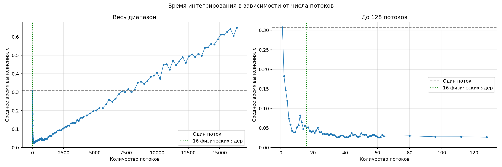

# Интегрирование методом Монте-Карло

Программа вычисляет интеграл sin(x) на отрезке [0, 1] методом Монте-Карло, используя <num_of_threads> потоков. Квадрат [0, 1] × [0, 1] делится на равные вертикальные полосы — по одной на поток. Каждый поток генерирует случайные точки внутри своей полосы и подсчитывает точки под графиком sin(x). Затем результаты суммируются. Отношение общего числа точек под графиком к числу всех сгенерированных точек даёт приближённое значение интеграла, поскольку площадь квадрата равна 1.

## Сборка

Нужны Linux и GCC. Все команды выполняются из папки с исходниками.

```sh
gcc -std=c17 -O2 -Wall -Wextra generator.c generatorFuncs.c -o generator -pthread -lm -lrt
gcc -std=c17 -O2 -Wall -Wextra integrator.c integratorFuncs.c -o integrator -lm -lrt
```

## Запуск интегрирования на <num_of_threads> потоках

```sh
./integrator <num_of_threads>
```

## Запуск скрипта исследования зависимости времени работы программы от количества потоков
```sh
python3 benchmark.py
```

## Результаты исследования

Измерения проводились на Intel Core Ultra 9 285H с 16 физическими ядрами.
Число потоков изменялось от 1 до 16384. Для каждого значения выполнено
пять запусков. Сравнивалось среднее полное время выполнения программ,
включая создание потоков и ожидание их завершения.

| Число потоков | Среднее время, с | Ускорение относительно одного потока |
|---:|---:|---:|
| 1 | 0,3074 | 1,00 |
| 16 | 0,0507 | 6,07 |
| 61 | 0,0255 | 12,05 |
| 1024 | 0,0474 | 6,49 |
| 4096 | 0,1675 | 1,84 |
| 7680 | 0,3170 | 0,97 |
| 7936 | 0,2997 | 1,03 |
| 8192 | 0,3146 | 0,98 |
| 16384 | 0,6502 | 0,47 |



[Полная таблица измерений](timings.csv)

Использование 16 потоков вместо одного ускорило выполнение в **6,07 раза**.
Наименьшее среднее время среди проверенных вариантов получено при
**61 потоке — 0,0255 с**, что соответствует ускорению в **12,05 раза**.

После нескольких десятков потоков устойчивого дальнейшего ускорения
не наблюдалось. При увеличении числа потоков до нескольких тысяч время
заметно возрастало: для 4096 потоков оно составило **0,1675 с**,
а для 16384 — **0,6502 с**.

Вероятные причины замедления — рост затрат на создание потоков,
их планирование и синхронизацию. В этой реализации каждый поток
считает точки под графиком в своём диапазоне, затем один раз
захватывает мьютекс и увеличивает общий счётчик в разделяемой памяти.
Если несколько потоков одновременно пытаются захватить мьютекс,
часть из них ожидает его освобождения.

При **7680 потоках** среднее время впервые среди проверенных вариантов
превысило однопоточное — примерно на **3,1%**. Однако при 7936 потоках
оно снова оказалось немного меньше.

Начиная с **8192 потоков**, все проверенные варианты выполнялись
медленнее однопоточного. При **16384 потоках** время было примерно
в **2,12 раза больше**, чем при одном потоке. Таким образом,
в проведённом эксперименте достигнут диапазон, в котором накладные
расходы многопоточности превышают выигрыш от параллельных вычислений.
