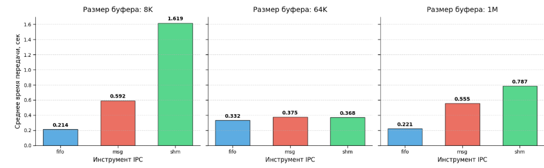

# Лабораторная работа: сравнение IPC в Linux

Сравнение трёх инструментов межпроцессного взаимодействия System V:
FIFO, очереди сообщений (MSG) и разделяемая память (SHM).

## Сборка

\`\`\`bash
gcc fifo.c -o fifo
gcc msg.c  -o msg
gcc shm.c  -o shm
\`\`\`

## Запуск

\`\`\`bash
./run_tests.sh
\`\`\`

## Результаты

Передача файла 100 МБ, время в секундах (среднее из 3 прогонов):

| Инструмент | 8 КБ  | 64 КБ | 1 МБ  |
|------------|-------|-------|-------|
| FIFO       | 0.214 | 0.332 | 0.221 |
| MSG        | 0.592 | 0.375 | 0.555 |
| SHM        | 1.619 | 0.368 | 0.787 |

## Выводы

- FIFO показал стабильные результаты на всех размерах буфера.
- MSG ограничен `MSGMAX` (8 КБ на сообщение), поэтому на больших буферах время растёт.
- SHM имеет большие накладные расходы на малом буфере из-за семафоров,
  но на 64 КБ и 1 МБ работает наравне с остальными.
- Все три инструмента корректно передают файл 100 МБ — md5sum совпадает.

