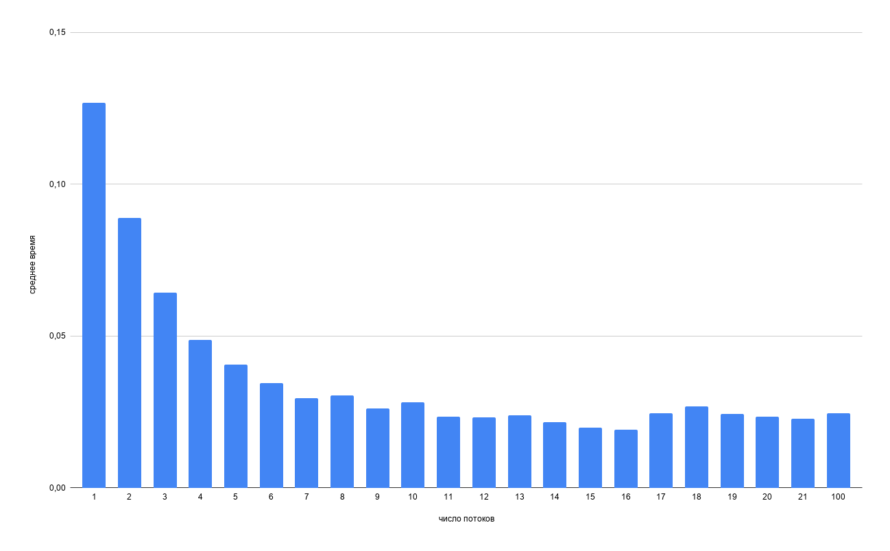
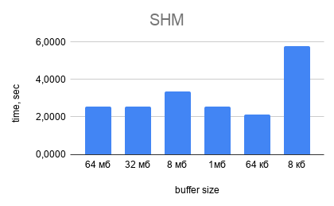
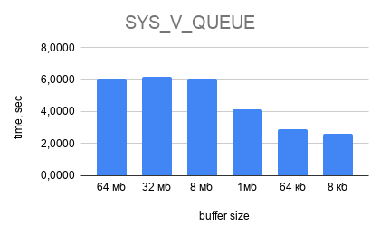
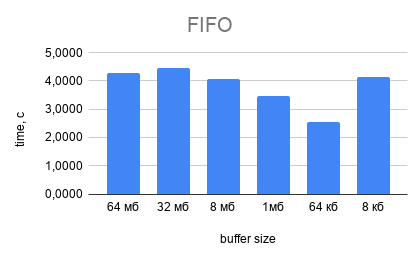

# 4 задание

<table border="1" cellspacing="0" cellpadding="2" style="border-collapse: collapse; text-align: center; font-family: sans-serif; font-size: 12px;">
<tr><th></th><th>1</th><th>2</th><th>3</th><th>4</th><th>5</th><th>6</th><th>7</th><th>8</th><th>9</th><th>10</th><th>11</th><th>12</th><th>13</th><th>14</th><th>15</th><th>16</th><th>17</th><th>18</th><th>19</th><th>20</th><th>21</th><th>103</th></tr>
<tr><td>1</td><td>0,1305</td><td>0,091</td><td>0,0676</td><td>0,0558</td><td>0,045</td><td>0,0399</td><td>0,0381</td><td>0,034</td><td>0,0432</td><td>0,043</td><td>0,0295</td><td>0,0285</td><td>0,0263</td><td>0,0244</td><td>0,0292</td><td>0,0268</td><td>0,0302</td><td>0,0302</td><td>0,0298</td><td>0,0313</td><td>0,0291</td><td>0,0368</td></tr>
<tr><td>2</td><td>0,119</td><td>0,0853</td><td>0,0602</td><td>0,0466</td><td>0,0374</td><td>0,0345</td><td>0,0323</td><td>0,0302</td><td>0,0293</td><td>0,0331</td><td>0,0368</td><td>0,0346</td><td>0,0405</td><td>0,0356</td><td>0,0304</td><td>0,0303</td><td>0,0338</td><td>0,0353</td><td>0,0299</td><td>0,0254</td><td>0,0351</td><td>0,037</td></tr>
<tr><td>3</td><td>0,1232</td><td>0,0845</td><td>0,063</td><td>0,0497</td><td>0,0373</td><td>0,0323</td><td>0,0316</td><td>0,0289</td><td>0,0292</td><td>0,0294</td><td>0,0247</td><td>0,0286</td><td>0,032</td><td>0,0269</td><td>0,0301</td><td>0,0233</td><td>0,0251</td><td>0,0251</td><td>0,0249</td><td>0,0214</td><td>0,0293</td><td>0,024</td></tr>
<tr><td>4</td><td>0,1212</td><td>0,0836</td><td>0,0619</td><td>0,0556</td><td>0,048</td><td>0,0333</td><td>0,0295</td><td>0,0294</td><td>0,031</td><td>0,0251</td><td>0,023</td><td>0,0209</td><td>0,0268</td><td>0,0222</td><td>0,0197</td><td>0,0229</td><td>0,0219</td><td>0,0257</td><td>0,0245</td><td>0,0231</td><td>0,0227</td><td>0,0238</td></tr>
<tr><td>5</td><td>0,12</td><td>0,0836</td><td>0,0561</td><td>0,0591</td><td>0,0426</td><td>0,0321</td><td>0,0279</td><td>0,0262</td><td>0,0279</td><td>0,0242</td><td>0,0246</td><td>0,0221</td><td>0,0203</td><td>0,0194</td><td>0,0212</td><td>0,0192</td><td>0,0232</td><td>0,0254</td><td>0,0238</td><td>0,0234</td><td>0,0246</td><td>0,0212</td></tr>
<tr><td>6</td><td>0,1191</td><td>0,0835</td><td>0,0602</td><td>0,0612</td><td>0,0409</td><td>0,0354</td><td>0,0291</td><td>0,0333</td><td>0,026</td><td>0,0278</td><td>0,0229</td><td>0,0227</td><td>0,0206</td><td>0,0197</td><td>0,0207</td><td>0,0169</td><td>0,0224</td><td>0,0252</td><td>0,0245</td><td>0,0233</td><td>0,0236</td><td>0,0227</td></tr>
<tr><td>7</td><td>0,125</td><td>0,0834</td><td>0,0556</td><td>0,0509</td><td>0,0385</td><td>0,0321</td><td>0,0277</td><td>0,0315</td><td>0,0275</td><td>0,0276</td><td>0,0229</td><td>0,0225</td><td>0,0188</td><td>0,0185</td><td>0,0203</td><td>0,0228</td><td>0,0243</td><td>0,0242</td><td>0,0232</td><td>0,0227</td><td>0,0234</td><td></td></tr>
<tr><td>8</td><td>0,1428</td><td>0,0844</td><td>0,058</td><td>0,0442</td><td>0,0382</td><td>0,0305</td><td>0,0282</td><td>0,0364</td><td>0,0268</td><td>0,0319</td><td>0,0227</td><td>0,0205</td><td>0,0202</td><td>0,0188</td><td>0,0193</td><td>0,0192</td><td>0,0244</td><td>0,0265</td><td>0,0229</td><td>0,0234</td><td>0,0228</td><td>0,0206</td></tr>
<tr><td>9</td><td>0,1346</td><td>0,095</td><td>0,0582</td><td>0,0471</td><td>0,036</td><td>0,0316</td><td>0,028</td><td>0,0318</td><td>0,026</td><td>0,0283</td><td>0,0226</td><td>0,0212</td><td>0,0205</td><td>0,0186</td><td>0,0215</td><td>0,018</td><td>0,0256</td><td>0,0263</td><td>0,023</td><td>0,0237</td><td>0,0226</td><td>0,0241</td></tr>
<tr><td>10</td><td>0,1256</td><td>0,0967</td><td>0,0672</td><td>0,0445</td><td>0,0362</td><td>0,0324</td><td>0,0285</td><td>0,0302</td><td>0,0249</td><td>0,0271</td><td>0,0223</td><td>0,0202</td><td>0,0211</td><td>0,0186</td><td>0,0196</td><td>0,0179</td><td>0,0235</td><td>0,0262</td><td>0,0226</td><td>0,0223</td><td>0,0224</td><td>0,0283</td></tr>
<tr><td>11</td><td>0,1406</td><td>0,0926</td><td>0,067</td><td>0,0445</td><td>0,0359</td><td>0,0321</td><td>0,0303</td><td>0,028</td><td>0,0251</td><td>0,0303</td><td>0,0217</td><td>0,0213</td><td>0,0217</td><td>0,02</td><td>0,019</td><td>0,0166</td><td>0,0257</td><td>0,0299</td><td>0,0238</td><td>0,0232</td><td>0,022</td><td>0,026</td></tr>
<tr><td>12</td><td>0,1359</td><td>0,1012</td><td>0,0653</td><td>0,0451</td><td>0,0363</td><td>0,0317</td><td>0,0279</td><td>0,0275</td><td>0,024</td><td>0,0272</td><td>0,0232</td><td>0,0215</td><td>0,0229</td><td>0,0233</td><td>0,0186</td><td>0,0174</td><td>0,0238</td><td>0,0268</td><td>0,0227</td><td>0,0222</td><td>0,0212</td><td>0,0239</td></tr>
<tr><td>13</td><td>0,1361</td><td>0,0881</td><td>0,0614</td><td>0,044</td><td>0,0351</td><td>0,0303</td><td>0,0274</td><td>0,0281</td><td>0,0247</td><td>0,0238</td><td>0,0228</td><td>0,0212</td><td>0,0215</td><td>0,0202</td><td>0,0191</td><td>0,0164</td><td>0,0285</td><td>0,0276</td><td>0,0237</td><td>0,0231</td><td>0,0213</td><td>0,022</td></tr>
<tr><td>14</td><td>0,1312</td><td>0,0914</td><td>0,068</td><td>0,0457</td><td>0,0401</td><td>0,03</td><td>0,0273</td><td>0,0284</td><td>0,0254</td><td>0,0258</td><td>0,0222</td><td>0,0212</td><td>0,0218</td><td>0,0202</td><td>0,0184</td><td>0,016</td><td>0,025</td><td>0,0251</td><td>0,0234</td><td>0,0222</td><td>0,0213</td><td>0,0221</td></tr>
<tr><td>15</td><td>0,1257</td><td>0,089</td><td>0,0655</td><td>0,0435</td><td>0,0401</td><td>0,0312</td><td>0,0285</td><td>0,0269</td><td>0,0262</td><td>0,0259</td><td>0,0223</td><td>0,0204</td><td>0,0235</td><td>0,0228</td><td>0,0188</td><td>0,0169</td><td>0,0243</td><td>0,0265</td><td>0,0223</td><td>0,0233</td><td>0,0214</td><td>0,0242</td></tr>
<tr><td>16</td><td>0,122</td><td>0,0859</td><td>0,0724</td><td>0,0453</td><td>0,0434</td><td>0,0325</td><td>0,0283</td><td>0,0315</td><td>0,0254</td><td>0,0246</td><td>0,022</td><td>0,0213</td><td>0,0217</td><td>0,0213</td><td>0,0171</td><td>0,0175</td><td>0,0237</td><td>0,0254</td><td>0,023</td><td>0,0241</td><td>0,021</td><td>0,0187</td></tr>
<tr><td>17</td><td>0,1305</td><td>0,0898</td><td>0,0726</td><td>0,0462</td><td>0,0539</td><td>0,0316</td><td>0,0298</td><td>0,0295</td><td>0,0254</td><td>0,0254</td><td>0,0218</td><td>0,0287</td><td>0,0202</td><td>0,0224</td><td>0,0192</td><td>0,0165</td><td>0,0231</td><td>0,0268</td><td>0,0238</td><td>0,0258</td><td>0,0224</td><td>0,0226</td></tr>
<tr><td>18</td><td>0,1155</td><td>0,0936</td><td>0,0696</td><td>0,046</td><td>0,0468</td><td>0,0423</td><td>0,0304</td><td>0,0308</td><td>0,0248</td><td>0,0351</td><td>0,022</td><td>0,0292</td><td>0,0214</td><td>0,024</td><td>0,0181</td><td>0,0164</td><td>0,0234</td><td>0,0249</td><td>0,0245</td><td>0,0231</td><td>0,0213</td><td>0,024</td></tr>
<tr><td>19</td><td>0,1186</td><td>0,0912</td><td>0,0719</td><td>0,0497</td><td>0,0464</td><td>0,0509</td><td>0,0315</td><td>0,0357</td><td>0,0252</td><td>0,0332</td><td>0,0217</td><td>0,0215</td><td>0,0217</td><td>0,0192</td><td>0,0188</td><td>0,0168</td><td>0,0233</td><td>0,0266</td><td>0,0252</td><td>0,0233</td><td>0,0216</td><td>0,0278</td></tr>
<tr><td>20</td><td>0,1228</td><td>0,0863</td><td>0,0687</td><td>0,055</td><td>0,0395</td><td>0,05</td><td>0,0367</td><td>0,0345</td><td>0,0252</td><td>0,0304</td><td>0,0215</td><td>0,021</td><td>0,0335</td><td>0,0207</td><td>0,0177</td><td>0,0172</td><td>0,0232</td><td>0,0278</td><td>0,0241</td><td>0,0233</td><td>0,0214</td><td>0,0256</td></tr>
<tr><td><b>среднее</b></td><td>0,126810</td><td>0,0889</td><td>0,0643576</td><td>0,0486263</td><td>0,0406631</td><td>0,0345684</td><td>0,029521</td><td>0,0304631</td><td>0,0261684</td><td>0,0281421</td><td>0,023378</td><td>0,0232421</td><td>0,023936</td><td>0,0217263</td><td>0,0199105</td><td>0,0191</td><td>0,0244684</td><td>0,026705</td><td>0,024278</td><td>0,0234894</td><td>0,022773</td><td>0,0246</td></tr>
</table>
 
<table border="1" cellspacing="0" cellpadding="2" style="border-collapse: collapse; text-align: center; font-family: sans-serif; font-size: 12px;">
<tr><td><b>число потоков</b></td><td>1</td><td>2</td><td>3</td><td>4</td><td>5</td><td>6</td><td>7</td><td>8</td><td>9</td><td>10</td><td>11</td><td>12</td><td>13</td><td>14</td><td>15</td><td>16</td><td>17</td><td>18</td><td>19</td><td>20</td><td>21</td><td>103</td></tr>
<tr><td><b>среднее время</b></td><td>0,126810</td><td>0,0889</td><td>0,0643576</td><td>0,0486263</td><td>0,0406631</td><td>0,0345684</td><td>0,029521</td><td>0,0304631</td><td>0,0261684</td><td>0,0281421</td><td>0,023378</td><td>0,0232421</td><td>0,023936</td><td>0,0217263</td><td>0,0199105</td><td>0,0191</td><td>0,0244684</td><td>0,026705</td><td>0,024278</td><td>0,0234894</td><td>0,022773</td><td>0,0246</td></tr>
</table>

    

Когда число потоков меняется от 1 до 4 время выполнения программы падает быстро

После 4 потоков скорость падения сильно замедляется и так до 16 потоков (числа ядер)

Затем время начинает снова расти из-за переключения пготоков на ядрах (16 - 18)

Далее оно выходит к константному значению.

# 3 задание
## Выбор конфигурации размеров буфера

Для сравнения эффективности IPC-механизмов (SHM, очереди сообщений System V, FIFO) при передаче файла объемом **4 ГБ** были выбраны три группы размеров буфера:

*   **«Малый размер» (8 КБ и 64 КБ)** — порядок максимального размера сообщения для очереди. Значение **8 КБ** является дефолтным лимитом ядра Linux (`kernel.msgmax`). Эти тесты показывают максимальные накладные расходы на системные вызовы и переключение контекста из-за огромного количества итераций.
*   **«Средний размер» (1 МБ и 8 МБ)** — порядок размера буфера FIFO. Значение **1 МБ** соответствует системному лимиту Linux на максимальный размер пайпа для пользователя.
*   **«Большой размер» (32 МБ и 64 МБ)** — существенно больше размера буфера FIFO. Буферы в 32–64 раза превышают лимит пайпа. На этих объемах FIFO упирается в ограничение ядра и вынужден дробить данные, в то время как разделяемая память (SHM) полностью раскрывает свой потенциал, работая напрямую с RAM без промежуточного копирования данных через ядро.

<h2 style="text-align: center;"> Таблицы всех замеров времени (в секундах) </h2>

<h3 style="text-align: center;">SHM (Shared Memory)</h3>

<table border="1" style="border-collapse: collapse; border: 2px solid;">
  <thead>
    <tr>
      <th colspan="2" style="border-right: 2px solid;">64 мб</th>
      <th colspan="2" style="border-right: 2px solid;">32 мб</th>
      <th colspan="2" style="border-right: 2px solid;">8 мб</th>
      <th colspan="2" style="border-right: 2px solid;">1 мб</th>
      <th colspan="2" style="border-right: 2px solid;">64 кб</th>
      <th colspan="2">8 кб</th>
    </tr>
    <tr>
      <th>test</th><th style="border-right: 2px solid;">time, sec</th>
      <th>test</th><th style="border-right: 2px solid;">time, sec</th>
      <th>test</th><th style="border-right: 2px solid;">time, sec</th>
      <th>test</th><th style="border-right: 2px solid;">time, sec</th>
      <th>test</th><th style="border-right: 2px solid;">time, sec</th>
      <th>test</th><th style="border-right: 2px solid;">time, sec</th>

  </thead>
  <tbody>
    <tr>
      <td>1</td><td style="border-right: 2px solid;">2,34929</td><td>1</td><td style="border-right: 2px solid;">2,34864</td><td>1</td><td style="border-right: 2px solid;">2,61912</td><td>1</td><td style="border-right: 2px solid;">2,52939</td><td>1</td><td style="border-right: 2px solid;">2,20435</td><td>1</td><td>5,56269</td>
    </tr>
    <tr>
      <td>2</td><td style="border-right: 2px solid;">3,31639</td><td>2</td><td style="border-right: 2px solid;">3,22345</td><td>2</td><td style="border-right: 2px solid;">3,93374</td><td>2</td><td style="border-right: 2px solid;">3,17177</td><td>2</td><td style="border-right: 2px solid;">2,01614</td><td>2</td><td>5,71988</td>
    </tr>
    <tr>
      <td>3</td><td style="border-right: 2px solid;">2,32457</td><td>3</td><td style="border-right: 2px solid;">2,4042</td><td>3</td><td style="border-right: 2px solid;">3,13453</td><td>3</td><td style="border-right: 2px solid;">2,69282</td><td>3</td><td style="border-right: 2px solid;">2,0391</td><td>3</td><td>5,82955</td>
    </tr>
    <tr>
      <td>4</td><td style="border-right: 2px solid;">2,43797</td><td>4</td><td style="border-right: 2px solid;">2,23617</td><td>4</td><td style="border-right: 2px solid;">3,47708</td><td>4</td><td style="border-right: 2px solid;">2,25545</td><td>4</td><td style="border-right: 2px solid;">2,27912</td><td>4</td><td>6,22455</td>
    </tr>
    <tr>
      <td>5</td><td style="border-right: 2px solid;">2,39052</td><td>5</td><td style="border-right: 2px solid;">2,45423</td><td>5</td><td style="border-right: 2px solid;">3,679</td><td>5</td><td style="border-right: 2px solid;">2,17147</td><td>5</td><td style="border-right: 2px solid;">2,03927</td><td>5</td><td>5,53963</td>
    </tr>
    <tr style="border-top: 2px solid;">
      <td><b>среднее</b></td><td style="border-right: 2px solid;"><b>2,563748</b></td><td><b>среднее</b></td><td style="border-right: 2px solid;"><b>2,53338</b></td><td><b>среднее</b></td><td style="border-right: 2px solid;"><b>3,368694</b></td><td><b>среднее</b></td><td style="border-right: 2px solid;"><b>2,56418</b></td><td><b>среднее</b></td><td style="border-right: 2px solid;"><b>2,115596</b></td><td><b>среднее</b></td><td><b>5,77526</b></td>
    </tr>
  </tbody>
</table>

<table border="1" style="border-collapse: collapse; border: 2px solid;">
  <thead>
    <tr>
      <th style="font-weight: bold; border-right: 2px solid; padding: 4px 10px;">buffer size</th>
      <td style="font-weight: normal; padding: 4px 10px;">64 мб</td>
      <td style="font-weight: normal; padding: 4px 10px;">32 мб</td>
      <td style="font-weight: normal; padding: 4px 10px;">8 мб</td>
      <td style="font-weight: normal; padding: 4px 10px;">1мб</td>
      <td style="font-weight: normal; padding: 4px 10px;">64 кб</td>
      <td style="font-weight: normal; padding: 4px 10px;">8 кб</td>
    </tr>
  </thead>
  <tbody>
    <tr>
      <th style="font-weight: bold; border-right: 2px solid; padding: 4px 10px;">time, secs</th>
      <td style="padding: 4px 10px;">2,5637</td>
      <td style="padding: 4px 10px;">2,5333</td>
      <td style="padding: 4px 10px;">3,3687</td>
      <td style="padding: 4px 10px;">2,5642</td>
      <td style="padding: 4px 10px;">2,1156</td>
      <td style="padding: 4px 10px;">5,7753</td>
    </tr>
  </tbody>
</table>

    >

<h3 style="text-align: center;"> SYS V QUEUE </h3>

<table border="1" style="border-collapse: collapse; border: 2px solid;">
  <thead>
    <tr>
      <th colspan="2" style="border-right: 2px solid;">64 мб</th>
      <th colspan="2" style="border-right: 2px solid;">32 мб</th>
      <th colspan="2" style="border-right: 2px solid;">8 мб</th>
      <th colspan="2" style="border-right: 2px solid;">1 мб</th>
      <th colspan="2" style="border-right: 2px solid;">64 кб</th>
      <th colspan="2">8 кб</th>
    </tr>
    <tr>
      <th>test</th><th style="border-right: 2px solid;">time, sec</th>
      <th>test</th><th style="border-right: 2px solid;">time, sec</th>
      <th>test</th><th style="border-right: 2px solid;">time, sec</th>
      <th>test</th><th style="border-right: 2px solid;">time, sec</th>
      <th>test</th><th style="border-right: 2px solid;">time, sec</th>
      <th>test</th><th style="border-right: 2px solid;">time, sec</th>
    </tr>
  </thead>
  <tbody>
    <tr>
      <td>1</td><td style="border-right: 2px solid;">5,15321</td><td>1</td><td style="border-right: 2px solid;">5,15095</td><td>1</td><td style="border-right: 2px solid;">5,16418</td><td>1</td><td style="border-right: 2px solid;">4,16288</td><td>1</td><td style="border-right: 2px solid;">2,67582</td><td>1</td><td>2,57165</td>
    </tr>
    <tr>
      <td>2</td><td style="border-right: 2px solid;">6,50066</td><td>2</td><td style="border-right: 2px solid;">6,76811</td><td>2</td><td style="border-right: 2px solid;">6,53036</td><td>2</td><td style="border-right: 2px solid;">4,17245</td><td>2</td><td style="border-right: 2px solid;">2,73766</td><td>2</td><td>2,63304</td>
    </tr>
    <tr>
      <td>3</td><td style="border-right: 2px solid;">6,33888</td><td>3</td><td style="border-right: 2px solid;">6,27445</td><td>3</td><td style="border-right: 2px solid;">6,23539</td><td>3</td><td style="border-right: 2px solid;">3,85657</td><td>3</td><td style="border-right: 2px solid;">2,66842</td><td>3</td><td>2,6181</td>
    </tr>
    <tr>
      <td>4</td><td style="border-right: 2px solid;">6,53537</td><td>4</td><td style="border-right: 2px solid;">6,20329</td><td>4</td><td style="border-right: 2px solid;">5,91238</td><td>4</td><td style="border-right: 2px solid;">4,55741</td><td>4</td><td style="border-right: 2px solid;">2,85823</td><td>4</td><td>2,60366</td>
    </tr>
    <tr>
      <td>5</td><td style="border-right: 2px solid;">5,86044</td><td>5</td><td style="border-right: 2px solid;">6,50255</td><td>5</td><td style="border-right: 2px solid;">6,34366</td><td>5</td><td style="border-right: 2px solid;">3,88829</td><td>5</td><td style="border-right: 2px solid;">3,5034</td><td>5</td><td>2,61765</td>
    </tr>
    <tr style="border-top: 2px solid;">
      <td><b>среднее</b></td><td style="border-right: 2px solid;"><b>6,077712</b></td><td><b>среднее</b></td><td style="border-right: 2px solid;"><b>6,17987</b></td><td><b>среднее</b></td><td style="border-right: 2px solid;"><b>6,037194</b></td><td><b>среднее</b></td><td style="border-right: 2px solid;"><b>4,12752</b></td><td><b>среднее</b></td><td style="border-right: 2px solid;"><b>2,888706</b></td><td><b>среднее</b></td><td><b>2,60882</b></td>
    </tr>
  </tbody>
</table>

<table border="1" style="border-collapse: collapse; border: 2px solid;">
  <thead>
    <tr>
      <th style="font-weight: bold; border-right: 2px solid; padding: 4px 10px;">buffer size</th>
      <td style="font-weight: normal; padding: 4px 10px;">64 мб</td>
      <td style="font-weight: normal; padding: 4px 10px;">32 мб</td>
      <td style="font-weight: normal; padding: 4px 10px;">8 мб</td>
      <td style="font-weight: normal; padding: 4px 10px;">1мб</td>
      <td style="font-weight: normal; padding: 4px 10px;">64 кб</td>
      <td style="font-weight: normal; padding: 4px 10px;">8 кб</td>
    </tr>
  </thead>
  <tbody>
    <tr>
      <th style="font-weight: bold; border-right: 2px solid; padding: 4px 10px;">time, secs</th>
      <td style="padding: 4px 10px;">6,0777</td>
      <td style="padding: 4px 10px;">6,1799</td>
      <td style="padding: 4px 10px;">6,0372</td>
      <td style="padding: 4px 10px;">4,1275</td>
      <td style="padding: 4px 10px;">2,8887</td>
      <td style="padding: 4px 10px;">2,6088</td>
    </tr>
  </tbody>
</table>

    

<h3 style="text-align: center;">FIFO</h3>

<table border="1" style="border-collapse: collapse; border: 2px solid;">
  <thead>
    <tr>
      <th colspan="2" style="border-right: 2px solid;">64 мб</th>
      <th colspan="2" style="border-right: 2px solid;">32 мб</th>
      <th colspan="2" style="border-right: 2px solid;">8 мб</th>
      <th colspan="2" style="border-right: 2px solid;">1 мб</th>
      <th colspan="2" style="border-right: 2px solid;">64 кб</th>
      <th colspan="2">8 кб</th>
    </tr>
    <tr>
      <th>test</th><th style="border-right: 2px solid;">time, sec</th>
      <th>test</th><th style="border-right: 2px solid;">time, sec</th>
      <th>test</th><th style="border-right: 2px solid;">time, sec</th>
      <th>test</th><th style="border-right: 2px solid;">time, sec</th>
      <th>test</th><th style="border-right: 2px solid;">time, sec</th>
      <th>test</th><th style="border-right: 2px solid;">time, sec</th>
    </tr>
  </thead>
  <tbody>
    <tr>
      <td>1</td><td style="border-right: 2px solid;">4,12837</td><td>1</td><td style="border-right: 2px solid;">4,40254</td><td>1</td><td style="border-right: 2px solid;">4,05693</td><td>1</td><td style="border-right: 2px solid;">3,60645</td><td>1</td><td style="border-right: 2px solid;">2,50272</td><td>1</td><td>4,16811</td>
    </tr>
    <tr>
      <td>2</td><td style="border-right: 2px solid;">4,2676</td><td>2</td><td style="border-right: 2px solid;">4,55969</td><td>2</td><td style="border-right: 2px solid;">4,14393</td><td>2</td><td style="border-right: 2px solid;">3,59785</td><td>2</td><td style="border-right: 2px solid;">2,53361</td><td>2</td><td>4,07145</td>
    </tr>
    <tr>
      <td>3</td><td style="border-right: 2px solid;">4,20489</td><td>3</td><td style="border-right: 2px solid;">4,46566</td><td>3</td><td style="border-right: 2px solid;">3,99227</td><td>3</td><td style="border-right: 2px solid;">3,37085</td><td>3</td><td style="border-right: 2px solid;">2,68431</td><td>3</td><td>4,03362</td>
    </tr>
    <tr>
      <td>4</td><td style="border-right: 2px solid;">4,30805</td><td>4</td><td style="border-right: 2px solid;">4,43222</td><td>4</td><td style="border-right: 2px solid;">4,18025</td><td>4</td><td style="border-right: 2px solid;">3,37566</td><td>4</td><td style="border-right: 2px solid;">2,50988</td><td>4</td><td>4,18189</td>
    </tr>
    <tr>
      <td>5</td><td style="border-right: 2px solid;">4,47157</td><td>5</td><td style="border-right: 2px solid;">4,35818</td><td>5</td><td style="border-right: 2px solid;">4,04189</td><td>5</td><td style="border-right: 2px solid;">3,44547</td><td>5</td><td style="border-right: 2px solid;">2,49755</td><td>5</td><td>4,19305</td>
    </tr>
    <tr style="border-top: 2px solid;">
      <td><b>среднее</b></td><td style="border-right: 2px solid;"><b>4,276096</b></td><td><b>среднее</b></td><td style="border-right: 2px solid;"><b>4,443658</b></td><td><b>среднее</b></td><td style="border-right: 2px solid;"><b>4,083054</b></td><td><b>среднее</b></td><td style="border-right: 2px solid;"><b>3,479256</b></td><td><b>среднее</b></td><td style="border-right: 2px solid;"><b>2,545614</b></td><td><b>среднее</b></td><td><b>4,129624</b></td>
    </tr>
  </tbody>
</table>

<table border="1" style="border-collapse: collapse; border: 2px solid;">
  <thead>
    <tr>
      <th style="font-weight: bold; border-right: 2px solid; padding: 4px 10px;">buffer size</th>
      <td style="font-weight: normal; padding: 4px 10px;">64 мб</td>
      <td style="font-weight: normal; padding: 4px 10px;">32 мб</td>
      <td style="font-weight: normal; padding: 4px 10px;">8 мб</td>
      <td style="font-weight: normal; padding: 4px 10px;">1мб</td>
      <td style="font-weight: normal; padding: 4px 10px;">64 кб</td>
      <td style="font-weight: normal; padding: 4px 10px;">8 кб</td>
    </tr>
  </thead>
  <tbody>
    <tr>
      <th style="font-weight: bold; border-right: 2px solid; padding: 4px 10px;">time, secs</th>
      <td style="padding: 4px 10px;">4,2761</td>
      <td style="padding: 4px 10px;">4,4437</td>
      <td style="padding: 4px 10px;">4,0831</td>
      <td style="padding: 4px 10px;">3,4793</td>
      <td style="padding: 4px 10px;">2,5456</td>
      <td style="padding: 4px 10px;">4,1296</td>
    </tr>
  </tbody>
</table>

    

## 