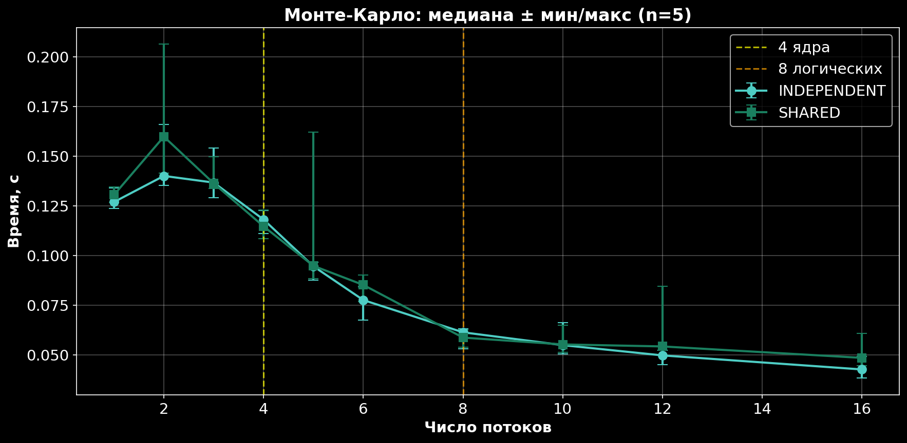

# ДЗ №4 — Метод Монте-Карло и многопоточность

Исследование масштабируемости параллельных вычислений на примере
метода Монте-Карло для вычисления определённого интеграла.

### Аппаратное обеспечение

| Параметр | Значение |
|----------|----------|
| **Устройство** | LAPTOP-E2BJPKCR |
| **Процессор** | Intel(R) Core(TM) i5-10300H CPU @ 2.50GHz |
| **Кодовое имя** | Comet Lake (10-е поколение) |
| **Физические ядра** | **4** |
| **Логические потоки** | **8** (гипертрединг 2× на ядро) |
| **Базовая частота** | 2.50 GHz |
| **Максимальная частота** | 4.50 GHz |
| **Кэш L3** | 8 MiB |
| **ОЗУ** | 8.00 ГБ (доступно: 7.87 ГБ) |
| **ОЗУ в WSL** | ~3.8 ГБ (ограничение WSL) |
| **Накопитель** | 477 GB SSD SK Hynix HFS512GD9TNI-L2A0B (NVMe) |
| **Дискретная GPU** | NVIDIA GeForce GTX 1650 Ti (4 GB) |
| **Встроенная GPU** | Intel UHD Graphics (128 MB) |
| **Архитектура** | x86_64 |

### Программное обеспечение

| Параметр | Значение |
|----------|----------|
| **ОС** | Windows 10/11 + Ubuntu (WSL 2) |
| **Компилятор** | gcc |
| **Флаги компиляции** | `-Wall -Wextra -I. -O2` |
| **Число точек** | 10 000 000 |
| **Функция** | `f(x) = exp(x)` |
| **Интервал** | x ∈ [0, 1], y ∈ [0, e] |

### Замечания

1. **WSL 2** — среда исполнения. **Не нативный Linux.** Планировщик Windows
   может влиять на распределение потоков между ядрами. Это **влияет**
   на масштабируемость .

2. **ОЗУ в WSL** ограничена 3.8 ГБ (по умолчанию — 50% RAM).
   Для 16 потоков × 625 000 точек **этого достаточно**

3. **Гипертрединг** — 8 логических потоков на 4 физических ядра.
   При `n > 4` **пары** потоков делят **одно** ядро — ускорение
   **замедляется**.

## Что реализовано

**Две программы**, общающиеся через **разделяемую память System V**:

| Программа | Файл | Что делает |
|-----------|------|------------|
| **А** (`worker`) | `worker.c` | Считает интеграл в `n` потоков, пишет в shm |
| **Б** (`reader`) | `reader.c` | Читает результаты из shm |

### Функция

```
f(x) = exp(x)
```

**Интеграл:** `∫₀¹ eˣ dx = e - 1 ≈ 1.7182818285`.

**Аналитическое значение** используется для проверки точности.

### Метод Монте-Карло

Прямоугольник `[0,1] × [0,e]`. Бросаем `TOTAL_POINTS = 10 000 000`
случайных точек. Считаем, сколько попало **под график** `y ≤ f(x)`.

```
I ≈ (x_max - x_min) × (y_max - y_min) × M / N
```

Где `M` — точек под графиком, `N` — всего.

### Два режима хранения результатов

| Режим | Что | Синхронизация |
|-------|-----|:---:|
| `MODE_INDEPENDENT` | Каждый поток пишет в **свою** ячейку |  - |
| `MODE_SHARED` | Все потоки пишут в **общую** ячейку |  `pthread_mutex` |

**Сравнение режимов** — влияние синхронизации на производительность.

## Структура файлов

| Файл | Назначение |
|------|------------|
| `monte_carlo.h` | Структуры `SharedResults`, `PthreadData`, прототипы |
| `worker.c` | Программа А: потоки, Монте-Карло, запись в shm |
| `reader.c` | Программа Б: чтение из shm, вывод |
| `main.c` | Точка входа программы А |
| `Makefile` | Сборка |
| `run.sh` | Серия измерений → `results.csv` |
| `graphs.py` | Графики |
| `results.csv` | Результаты замеров |

## Сборка

```bash
make            # релиз (по умолчанию)
make debug      # отладочная
make release    # релизная
make clean      # удалить build/
```

После сборки в `build/` появятся `worker` и `reader`.

## Запуск

### Один тест

```bash
# Программа А — 4 потока, INDEPENDENT
./build/worker 4 0

# Программа Б — читает из shm и удаляет её
./build/reader
```

**Второй аргумент `worker`:**
- `0` — `MODE_INDEPENDENT` (без мьютекса).
- `1` — `MODE_SHARED` (с мьютексом).

### Серия измерений

```bash
chmod +x run.sh
./run.sh
```

`run.sh`:

1. Прогоняет `n = 1, 2, 3, 4, 5, 6, 8, 10, 12, 16` для **двух** режимов.
2. **10 повторений** на каждую комбинацию (`REPEATS=10`).
3. Записывает результат в `results.csv`.
4. Удаляет shm между запусками.
5. В конце строит графики. **Требуется:** `matplotlib`, `numpy`.

**Ключ shm** создаётся через `ftok(SHM_KEY_PATH, SHM_KEY_ID)` — обе программы находят **один** сегмент.

## Методика измерений

**Замер времени** — `clock_gettime(CLOCK_MONOTONIC, ...)` в программе А:

```c
clock_gettime(CLOCK_MONOTONIC, &start);
/* запуск потоков, join */
clock_gettime(CLOCK_MONOTONIC, &end);
```

**Монотонные часы** — не зависят от системного времени.

**Повторения:** `REPEATS=10` на каждую комбинацию.
**В отчёте:** **медиана** (устойчива к выбросам), **минимум**, **максимум**.

## Результаты

| n | INDEPENDENT, с | SHARED, с |
|:-:|:---:|:---:|
| 1 | 0.1383 | 0.1323 |
| 2 | 0.1580 | 0.1510 |
| 3 | 0.1385 | 0.1360 |
| 4 | 0.1143 | 0.1115 |
| 5 | 0.0948 | 0.0935 |
| 6 | 0.0770 | 0.0774 |
| 8 | 0.0623 | 0.0598 |
| 10 | 0.0540 | 0.0544 |
| 12 | 0.0512 | 0.0494 |
| 16 | 0.0440 | 0.0403 |

## Анализ

### Speedup и Efficiency

| n | S(n) = t(1)/t(n) | E(n) = S(n)/n |
|:-:|:---:|:---:|
| 1 | 1.00 | 1.00 |
| 2 | **0.87** | 0.44 |
| 4 | 1.21 | 0.30 |
| 8 | 2.22 | 0.28 |
| 16 | 3.14 | 0.20 |

### Задача 1: прирост при n' = 4 (физические ядра)

```
S(4) = t(1) / t(4) = 0.138 / 0.114 = 1.21×
```

**Идеал:** ×4. **Реальность:** ×1.21. **Прирост слабый.**

**Причины:**

1. **Закон Амдала** — последовательная часть (создание потоков, join, инициализация) ограничивает: `S_max = 1/p`, где `p` — доля последовательного кода.
2. **Гипертрединг** — 2 потока на ядро **мешают** друг другу.
3. **WSL** — не даёт **полного** параллелизма: Windows-планировщик делит ядра между WSL и хостом.
4. **Малый объём** работы — 10 млн точек × `exp` = **0.14 с**. Оверхед `pthread` **сравним** с полезной работой.

### Задача 2: серия измерений

**Аномалия `n=2`:** время **0.158 с** — **больше**, чем при `n=1` (0.138 с). `S(2) = 0.87 < 1` — **стало медленнее**.

**Причина:** 2 потока на **одном** физическом ядре (гипертрединг) **конкурируют** за **один** L1/L2 кэш. **Плюс** — оверхед `pthread_create`/`join` **не перекрывается** выигрышем.

**Стагнация:** **не достигнута** до `n=16`. Время **монотонно падает** с 0.138 до 0.044 с.

**Деградация:** **не достигнута**. Нужно **расширить** диапазон до `n = 32, 64, 128, 256`.


## Выводы
## Результаты



1. **Ускорение есть**, но **не идеальное**: `S(4) = 1.21`, `S(16) = 3.14` вместо 4 и 16. Причина — **закон Амдала** и **гипертрединг**.

2. **Эффективность падает** с ростом `n`: `E(1) = 1.00`, `E(16) = 0.20`. **80% времени** — **потери** на синхронизацию, создание потоков, конкуренцию за память.

3. **Аномалия `n=2`** — 2 потока **медленнее** 1. **Гипертрединг** + **WSL** + **малый объём работы**.

4. **Стагнация и деградация не достигнуты** до 16. Нужно **продолжить** серию.

5. **Синхронизация не влияет** — `SHARED ≈ INDEPENDENT`. Мьютекс **редко вызывается**, оверхед **мал**.

6. **Для реального ускорения нужно:**
   - **нативный** Linux вместо WSL.
   - **больше** работы (100+ млн точек),
   - **меньше** последовательной части,
   - **больше** физических ядер,
   
## Ограничения

- **WSL** даёт **неполный** параллелизм — результаты **ниже** ожидаемых.
- **shm** нужно **удалять** (`reader` делает это через `shmctl(IPC_RMID)`).

## Автор

Рюмина Милана, 3 семестр, МФТИ.

