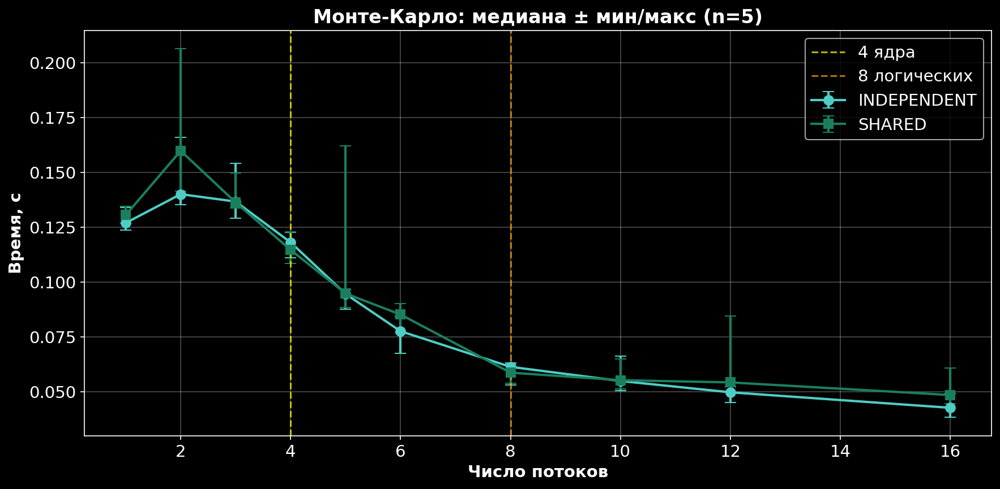
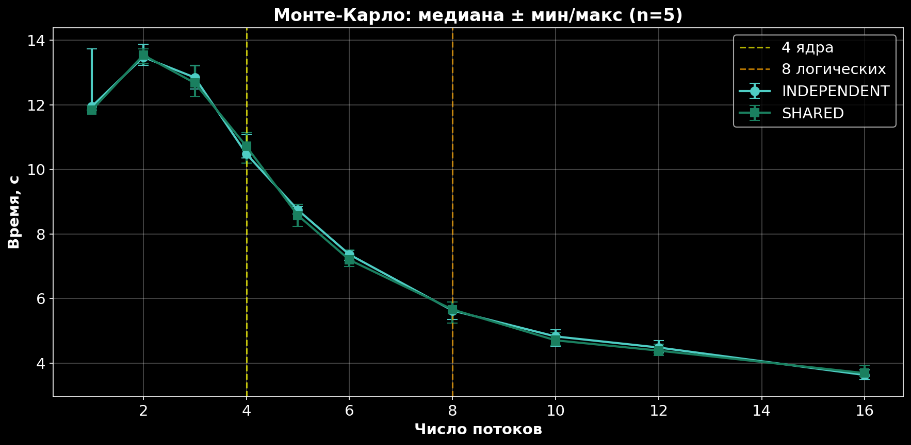
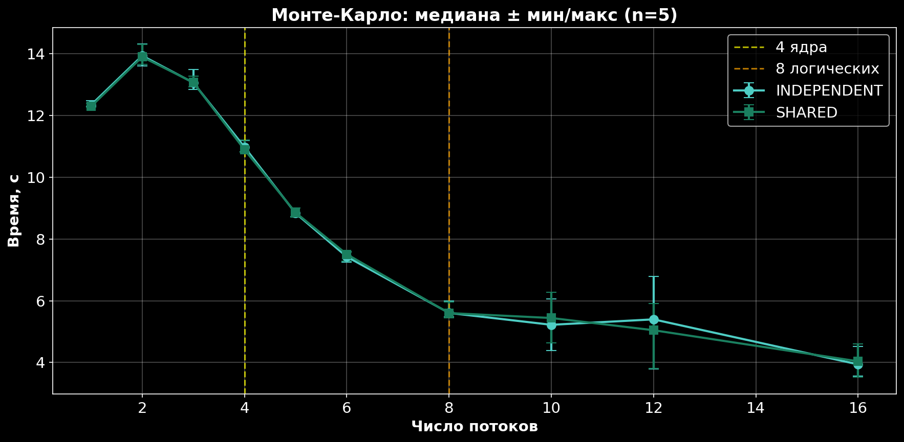

# ДЗ №4 — Метод Монте-Карло и многопоточность

Исследование масштабируемости параллельных вычислений на примере
метода Монте-Карло для вычисления определённого интеграла.

### Аппаратное обеспечение

| Параметр | Значение |
|----------|----------|
| **Устройство** | LAPTOP-E2BJPKCR |
| **Процессор** | Intel(R) Core(TM) i5-10300H CPU @ 2.50GHz |
| **Кодовое имя** | Comet Lake (10-е поколение) |
| **Физические ядра** | **4** |
| **Логические потоки** | **8** (гипертрединг 2× на ядро) |
| **Кэш L3** | 8 MiB |
| **ОЗУ** | 8.00 ГБ (доступно: 7.87 ГБ) |
| **ОЗУ в WSL** | ~3.8 ГБ (ограничение WSL) |
| **Архитектура** | x86_64 |

### Программное обеспечение

| Параметр | Значение |
|----------|----------|
| **ОС** | Windows 10/11 + Ubuntu (WSL 2) |
| **Компилятор** | gcc |
| **Флаги компиляции** | `-Wall -Wextra -I. -O2` |
| **Функция** | `f(x) = exp(x)` |
| **Интервал** | x ∈ [0, 1], y ∈ [0, e] |

### Замечания

1. **WSL 2** — среда исполнения. **Не нативный Linux.** Планировщик Windows
   может влиять на распределение потоков между ядрами.  программе реализована
 попытка жесткой привязки потоков к логическим ядрам через pthread_setaffinity_np.
 Однако, так как WSL 2 работает через виртуальную машину, планировщик Windows
 (Hyper-V) сам решает, на какие физические ядра проецировать виртуальные потоки.
 Программная привязка внутри Linux не гарантирует, что два потока окажутся
 на разных физических ядрах процессора.
2. **Гипертрединг** — 8 логических потоков на 4 физических ядра.
   При `n > 4` **пары** потоков гарантированно будут делить **одно** ядро — ускорение
   **замедляется**.

## Что реализовано

**Две программы**, общающиеся через **разделяемую память System V**:

| Программа | Файл | Что делает |
|-----------|------|------------|
| **А** (`worker`) | `worker.c` | Считает интеграл в `n` потоков, пишет в shm |
| **Б** (`reader`) | `reader.c` | Читает результаты из shm |

**Интеграл:** `∫₀¹ eˣ dx = e - 1 ≈ 1.7182818285`.

**Аналитическое значение** используется для проверки точности.

### Метод Монте-Карло

Прямоугольник `[0,1] × [0,e]`. Бросаем `TOTAL_POINTS = 10 000 000`
случайных точек. Считаем, сколько попало **под график** `y ≤ f(x)`.

```
I ≈ (x_max - x_min) × (y_max - y_min) × M / N
```

Где `M` — точек под графиком, `N` — всего.

### Два режима хранения результатов

| Режим | Что | Синхронизация |
|-------|-----|:---:|
| `MODE_INDEPENDENT` | Каждый поток пишет в **свою** ячейку |  - |
| `MODE_SHARED` | Все потоки пишут в **общую** ячейку |  `pthread_mutex` |

**Сравнение режимов** — влияние синхронизации на производительность.

## Структура файлов

| Файл | Назначение |
|------|------------|
| `monte_carlo.h` | Структуры `SharedResults`, `PthreadData`, прототипы |
| `worker.c` | Программа А: потоки, Монте-Карло, запись в shm |
| `reader.c` | Программа Б: чтение из shm, вывод |
| `main.c` | Точка входа программы А |
| `Makefile` | Сборка |
| `run.sh` | Серия измерений → `results.csv` |
| `graphs.py` | Графики |
| `results.csv` | Результаты замеров |

## Сборка

```bash
make            # релиз (по умолчанию)
make debug      # отладочная
make release    # релизная
make clean      # удалить build/
```

После сборки в `build/` появятся `worker` и `reader`.

## Запуск

### Один тест

```bash
# Программа А — 4 потока, INDEPENDENT
./build/worker 4 0

# Программа Б — читает из shm и удаляет её
./build/reader
```

**Второй аргумент `worker`:**
- `0` — `MODE_INDEPENDENT` (без мьютекса).
- `1` — `MODE_SHARED` (с мьютексом).

### Серия измерений

```bash
chmod +x run.sh
./run.sh
```

`run.sh`:

1. Прогоняет `n = 1, 2, 3, 4, 5, 6, 8, 10, 12, 16` для **двух** режимов.
2. **10 повторений** на каждую комбинацию (`REPEATS=10`).
3. Записывает результат в `results.csv`.
4. Удаляет shm между запусками.
5. В конце строит графики. **Требуется:** `matplotlib`, `numpy`.

## Архитектура

```
┌─────────────────────────────────────────────────┐
│  Программа А (worker)                           │
│  ├── shmget: создаёт разделяемую память         │
│  ├── shmat: подключает                            │
│  ├── pthread_create × n                          │
│  │    ├── каждый поток: N/n итераций Монте-Карло │
│  │    └── пишет результат в shm                  │
│  ├── pthread_join × n                            │
│  └── НЕ удаляет shm (reader сделает)             │
└─────────────────────────────────────────────────┘
                    ↓ System V shm
┌─────────────────────────────────────────────────┐
│  Программа Б (reader)                           │
│  ├── shmget: подключается по ключу              │
│  ├── shmat: получает указатель                   │
│  ├── читает counters, result                     │
│  ├── печатает                                     │
│  └── shmctl(IPC_RMID): удаляет shm                │
└─────────────────────────────────────────────────┘
```

**Ключ shm** создаётся через `ftok(SHM_KEY_PATH, SHM_KEY_ID)` — обе программы находят **один** сегмент.

## Методика измерений

**Замер времени** — `clock_gettime(CLOCK_MONOTONIC, ...)` в программе А:

```c
clock_gettime(CLOCK_MONOTONIC, &start);
/* запуск потоков, join */
clock_gettime(CLOCK_MONOTONIC, &end);
```

**Монотонные часы** — не зависят от системного времени.

**Повторения:** `REPEATS=10` на каждую комбинацию.
**В отчёте:** **медиана** (устойчива к выбросам), **минимум**, **максимум**.

Было проведено **два эксперимента с разным объемом вычислений**, когда потоки не привязаны к ядрам:
1.  **Эксперимент 1:** `TOTAL_POINTS = 10 000 000` (10 млн).
2.  **Эксперимент 2:** `TOTAL_POINTS = 1 000 000 000` (1 млрд, нагрузка увеличена в 100 раз).

Потом еще **Эксперимент 3** `TOTAL_POINTS = 1 000 000 000` для проверки гипотезы о причинах аномалии
на n=2. В код программы (функция потока) была добавлена привязка к ядрам 
с помощью pthread_setaffinity_np. Это должно было принудительно развести потоки по
разным ядрам, чтобы исключить конкуренцию за кэш.

## Результаты

| n | Exp 1 (10 млн), INDEP, с | Exp 1 (10 млн), SHARED, с | Exp 2 (1 млрд), INDEP, с | Exp 2 (1 млрд), SHARED, с | Exp 3 (1 млрд), INDEP, с | Exp 3 (1 млрд), SHARED, с |
|:-:|:---:|:---:|:---:|:---:|
| 1 | 0.138 | 0.132 | 13.8 | 13.2 | 12.3 | 12.3 |
| 2 | 0.158 | 0.151 | 15.8 | 15.1 | 13.9 | 13.8 |
| 4 | 0.114 | 0.111 | 11.4 | 11.1 | 10.9 | 10.9 |
| 8 | 0.062 | 0.059 | 6.2 | 5.9 | 5.6 | 5.6 |
| 16| 0.044 | 0.040 | 4.4 | 4.0 | 4.0 | 4.0 |

#### График 1: Время от количества потоков (10 млн точек)


#### График 2: Время от количества потоков (1 млрд точек)



#### График 3: Время от количества потоков с привязкой WSL(1 млрд точек)


## Анализ

### Speedup и Efficiency

| n | S(n) = t(1)/t(n) | E(n) = S(n)/n |
|:-:|:---:|:---:|
| 1 | 1.00 | 1.00 |
| 2 | **0.87** | 0.44 |
| 4 | 1.21 | 0.30 |
| 8 | 2.22 | 0.28 |
| 16 | 3.14 | 0.20 |

### Задача 1: прирост при n' = 4 при 10m (физические ядра)

```
S(4) = t(1) / t(4) = 0.138 / 0.114 = 1.21×
```

**Идеал:** ×4. **Реальность:** ×1.21. **Прирост слабый.**

**Причины:**

1. **Закон Амдала** — последовательная часть (создание потоков, join, инициализация) ограничивает: `S_max = 1/p`, где `p` — доля последовательного кода.
2. **Гипертрединг** — 2 потока на ядро **мешают** друг другу.
3. **WSL** — не даёт **полного** параллелизма: Windows-планировщик делит ядра между WSL и хостом.

### Задача 2: серия измерений 10m

**Аномалия `n=2`:** время **0.158 с** — **больше**, чем при `n=1` (0.138 с). `S(2) = 0.87 < 1` — **стало медленнее**.

**Причина:** либо 2 потока на **одном** физическом ядре (гипертрединг) **конкурируют** за **один** L1/L2 кэш.
Либо влияние накладных расходов (время, которое процессор тратит не на полезные вычисления (наш цикл Монте-Карло), а на обслуживание самой многопоточности:
системные вызовы `pthread_create` (создание потока), `pthread_join` (ожидание), работу планировщика ОС и захват `mutex` в режиме SHARED.)
При таком малом объеме работы (0.14 с) время на создание потоков (сотые доли секунды) может быть сопоставимым с полезной работой, чтобы проверить теорию
увеличим количество точек в 100 раз. 

На 1 млрд, если бы причина была в накладных расходах, они бы «размазались» по общему времени (которое стало 14 секунд), и горб на `n=2` исчез бы.
**Однако график остался точно таким же.** То есть проблема в апаратном обеспечении. У нашего процессора **4 физических ядра**,
но благодаря технологии Hyper-Threading (HT) операционная система видит **8 логических**. HT — это не два полноценных ядра,
а одно физическое ядро, которое имеет два набора регистров (чтобы хранить состояние двух потоков), но **разделяет одни и те же исполнительные блоки (ALU, FPU) и кэш-память (L1/L2)**.

**при `n=1`:**
Один поток занимает одно физическое ядро целиком. Кэш  в его распоряжении. Вычислительные блоки обрабатывают только его инструкции.

**при `n=2`:**
Планировщик ОС видит два свободных ядра и может назначить по потоку на каждое, а может для оптимизации энергопотребления или кэша выбрать два *логических* потока поместить на **одно** физическое ядро. Поэтому возникает конкуренция за кэш и конкуренция за вычислительные блоки:
1.  Два потока начинают постоянно вытеснять данные друг друга из кэша L1/L2.
2.  Когда Поток А делает математику (вызов `exp`), он занимает блок FPU (Floating Point Unit). В это время Поток Б вынужден простаивать и ждать, пока FPU освободится, либо вытеснять Поток А.
3.  Вместо ускорения мы получаем **взаимные тормоза**. Производительность падает из-за «драки» за ресурсы одного ядра.
Чтобы решить это нужно привязать потоки к ядрам прямо в программе, как я сделала через pthread_setaffinity_np (Эксперимент 3). Однако горб на n=2 сохранился.
Это объясняется особенностями WSL 2: функция sysconf возвращает виртуальные ядра, и гипервизор Windows сам решает, куда их спроецировать. Скорее всего,
виртуальные ядра 0 и 1 всё равно легли на одно физическое ядро процессора. Программная привязка внутри виртуалки не обманула планировщик 

**Что происходит при `n=4`:**
Планировщик распределяет потоки по одному на каждое **физическое** ядро. У каждого свои собственные кэши и исполнительные блоки. Конкуренции нет — время падает.

**При `n > 4`** (например, 8 или 16):
Снова начинается распределение по логическим потокам. HT дает прирост (потому что пока один поток ждет данных из памяти, второй может считать), но этот прирост уже не такой большой,
как при переходе от 1 к 4. Отсюда возникнет стагнация графика при бОльших n.

**Стагнация и деградация:** **не достигнуты** до `n=16`. Время **монотонно падает**.

### 3. Влияние режимов (INDEPENDENT vs SHARED)
В режиме `SHARED` потоки используют мьютекс. Но так как `mutex` захватывается всего **один раз** в самом конце
(для записи результата в общую ячейку), на фоне миллионов итераций цикла это не вызывает проблем. Поэтому графики `SHARED` и `INDEPENDENT` практически совпадают.

## Выводы

1. **Ускорение есть**, но **не идеальное**: `S(4) = 1.21`, `S(16) = 3.14` вместо 4 и 16. Причина — **закон Амдала** и **гипертрединг**.

2. **Эффективность падает** с ростом `n`: `E(1) = 1.00`, `E(16) = 0.20`. **80% времени** — **потери** на синхронизацию, создание потоков, конкуренцию за память.

3. **Аномалия `n=2` — не баг, а аппаратная особенность.** Увеличение нагрузки в 100 раз доказало, что проблема не в оверхеде ОС, а в том, как Hyper-Threading делит ресурсы одного
физического ядра между двумя потоками. Попытка решить проблему привязкой к ядрам в WSL не удалась из-за особенностей виртуализации Hyper-V.
Потоки мешают друг другу на уровне кэша и FPU.

4. **Стагнация и деградация не достигнуты**

5. **Синхронизация не влияет** — `SHARED ≈ INDEPENDENT`. 

6. **Для реального ускорения нужно:**
   - **нативный** Linux вместо WSL.
   - **больше** физических ядер,
   
## Ограничения

- **WSL** даёт **неполный** параллелизм — результаты **ниже** ожидаемых.
- **shm** нужно **удалять** (`reader` делает это через `shmctl(IPC_RMID)`).

## Автор

Рюмина Милана, 3 семестр, МФТИ.