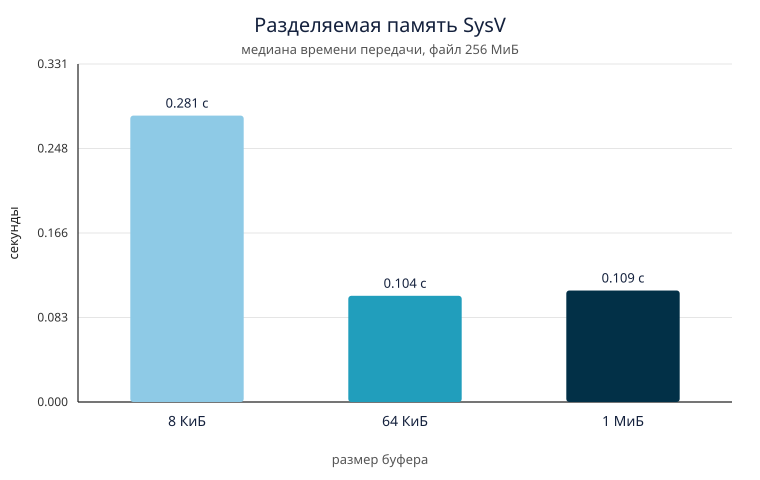
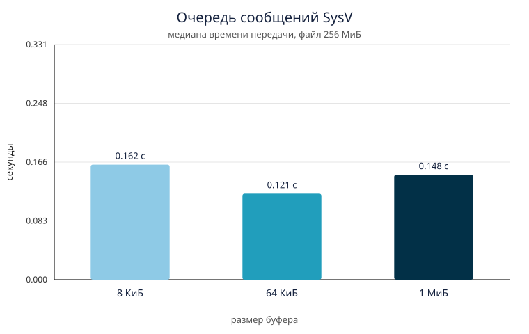
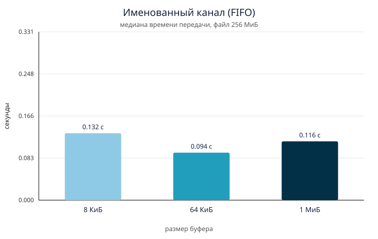

# Сравнение трёх способов IPC

Передача файла 256 МиБ между двумя процессами: разделяемая память SysV, очередь сообщений SysV и именованный канал FIFO. Целостность проверялась `md5sum`, время - часами `CLOCK_MONOTONIC` внутри программ. По медиане пяти прогонов построены три диаграммы: на каждой три столбца, по одному на размер буфера.

## Программы

Шесть исполняемых файлов, пара на каждый способ. Получатель создаёт канал и печатает `READY`, отправитель после этого читает файл и передаёт байты. Оба запуска принимают путь к файлу и размер буфера в байтах.

| Способ | Отправитель | Получатель | Как устроена передача |
| --- | --- | --- | --- |
| Разделяемая память SysV | `bin/shm_sender` | `bin/shm_receiver` | Один слот размера буфера и два семафора. Писатель кладёт кусок и ждёт, пока читатель его заберёт |
| Очередь сообщений SysV | `bin/mq_sender` | `bin/mq_receiver` | Пользовательский буфер режется на сообщения не длиннее 8192 байт. Получатель копит тот же буфер и делает один `write` |
| FIFO | `bin/fifo_sender` | `bin/fifo_receiver` | `write`/`read` кусками заданного размера. Ёмкость канала ядро не увеличивает |

Отправитель ставит отметку `CLOCK_MONOTONIC` после установки соединения и до чтения файла. Получатель останавливает часы сразу после записи последнего байта в выходной файл. В это время входят чтение входа, передача и запись выхода. Старт процессов и `fsync` в него не входят.

Ключ IPC лежит в `/tmp/ipc_lab_task3.key`, имя FIFO - `/tmp/ipc_lab_task3.fifo`.

## Размеры буфера

Лимиты моей машины в (`report/system.txt`):

- `kernel.msgmax = 8192` - максимум одного сообщения;
- `kernel.msgmnb = 16384` - максимум всей очереди;
- `F_GETPIPE_SZ = 65536` - ёмкость FIFO.

Отсюда три размера:

| | Байты | Почему такой |
| --- | --- | --- |
| малый | 8192 | порядок максимального сообщения очереди |
| средний | 65536 | порядок буфера FIFO |
| большой | 1048576 | в 16 раз больше буфера FIFO |

Очередь без правки ядра не принимает сообщение крупнее 8192 байт и держит в себе только 16 КиБ. Поэтому у MQ большой буфер не становится большим сообщением: отправитель по-прежнему делает 32768 вызовов `msgsnd` на файл 256 МиБ. Меняется число чтений файла и число записей у получателя.

## Как измерялось

- Файл 256 МиБ (268435456 байт) из `/dev/urandom`, md5 `dce880a11f27e07ed5dea741032480f6`.
- Вход и выход в tmpfs `/dev/shm`, чтобы сброс грязных страниц на диск не попадал во время.
- Отправитель закреплён на ядре 3, получатель на ядре 2 (`taskset`), процессор AMD Ryzen 9 7940HX, 32 ядра, ядро Linux 6.12.108-1-MANJARO.
- На каждую пару «способ + буфер»: один прогрев без записи в таблицу и пять рабочих прогонов, в отчёт идёт медиана.
- После каждого прогона `md5sum` выхода сравнивался с исходным. Совпали все 54 передачи прогрева и замера.

Сборка: `gcc -std=c11 -O2 -Wall -Wextra`.

## Результаты

Медиана времени и скорость, МиБ/с = 256 / время.

| Способ | 8 КиБ | 64 КиБ | 1 МиБ |
| --- | ---: | ---: | ---: |
| Разделяемая память | 0,281 с · 912 МиБ/с | 0,104 с · 2459 МиБ/с | 0,109 с · 2342 МиБ/с |
| Очередь сообщений | 0,162 с · 1579 МиБ/с | 0,121 с · 2111 МиБ/с | 0,148 с · 1731 МиБ/с |
| FIFO | 0,132 с · 1942 МиБ/с | 0,094 с · 2738 МиБ/с | 0,116 с · 2212 МиБ/с |

Разброс пяти прогонов узкий там, где результат самый устойчивый. У FIFO на 64 КиБ минимум 0,092 с, медиана 0,094 с, максимум 0,118 с. У разделяемой памяти на 64 КиБ все пять значений лежат в 0,103–0,107 с. Полные ряды - в `report/runs.csv`, сводка - в `report/summary.csv`.

Порядок на каждом размере буфера:

- 8 КиБ: FIFO, затем очередь, затем разделяемая память;
- 64 КиБ: FIFO, затем разделяемая память, затем очередь;
- 1 МиБ: разделяемая память, затем FIFO, затем очередь.

## Диаграммы

Общая шкала по вертикали в секундах, ноль внизу. Высоты столбцов можно сравнивать и внутри одной диаграммы, и между тремя файлами.

## Пример утилиты time

Отдельный прогон разделяемой памяти с буфером 64 КиБ. GNU `time` в системе нет, измеряла встроенная команда bash. Тот же прогон, те же ядра.

| | elapsed | user | sys |
| --- | ---: | ---: | ---: |
| получатель, `time` | 0,110 с | 0,004 с | 0,071 с |
| отправитель, `time` | 0,099 с | 0,008 с | 0,042 с |
| `CLOCK_MONOTONIC` получателя | 0,098 с | | |

Сырые строки: `report/time_receiver.txt`, `report/time_sender.txt`, `run/time_recv.out`. `md5sum` этого прогона тоже совпал.

Внешние часы получателя на этом прогоне длиннее внутренних на 0,012 с: в них входят старт процесса и ожидание, пока подключится отправитель. Для таблицы выше взяты внутренние часы: они начинаются до чтения файла и заканчиваются на последней записи.

У получателя пользовательское время 0,004 с, системное 0,071 с при общих 0,110 с. Основная работа - это копирование и ожидание в ядре, а не счёт в пользовательском цикле.

## Выводы

1. Файл доходит целиком всеми тремя способами. `md5sum` совпал на каждом прогоне, включая прогрев.

2. Самая быстрая передача - FIFO с буфером 64 КиБ: 0,094 с, около 2,7 ГиБ/с. Этот размер равен ёмкости канала в ядре. Отправитель и получатель на разных ядрах работают одновременно.

3. Разделяемая память сильнее всех зависит от буфера. На 8 КиБ процессов связывает 32768 рукопожатий семафора, они строго чередуются на одном слоте, время 0,281 с - худший результат таблицы. На 64 КиБ рукопожатий в восемь раз меньше, время падает до 0,104 с. На 1 МиБ рукопожатий остаётся 256, но время стоит на 0,109 с: копирование 256 МиБ уже дороже синхронизации, а рабочий кусок 1 МиБ хуже помещается в кэш, чем 64 КиБ.

4. У очереди сообщений число `msgsnd`/`msgrcv` одно и то же на всех трёх буферах: 32768 сообщений по 8192 байта плюс короткий заголовок. Очередь вмещает два таких сообщения. Поэтому столбцы близки. Выигрыш 64 КиБ относительно 8 КиБ (0,121 с против 0,162 с) даёт более редкий `write` у получателя. Буфер 1 МиБ снова медленнее (0,148 с): сообщений столько же, а большой промежуточный массив сильнее давит на кэш.

5. На большом буфере порядок меняется: разделяемая память (0,109 с) обходит FIFO (0,116 с). Слот памяти действительно равен 1 МиБ, а канал ядро по-прежнему прокачивает через 64 КиБ. Крупный пользовательский буфер FIFO не увеличивает буфер ядра.

6. Для всех трёх способов лучший из трёх размеров - 64 КиБ, то есть порядок буфера FIFO, а не самый большой буфер. Показательная точка здесь именно она: маленький буфер раздувает синхронизацию, большой упирается в кэш и в лимиты ядра.

7. Внутренние часы и `time` дают одну и ту же картину. `time` удобен как проверка сверху, внутренний интервал точнее отделяет саму передачу от запуска процессов.
