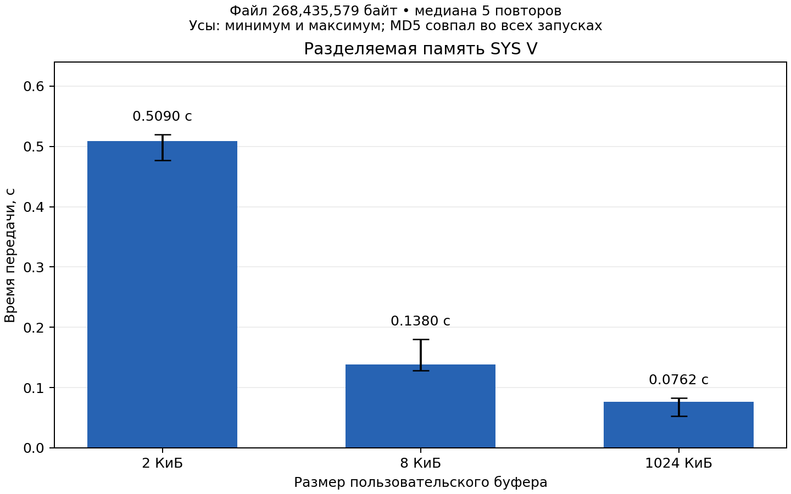
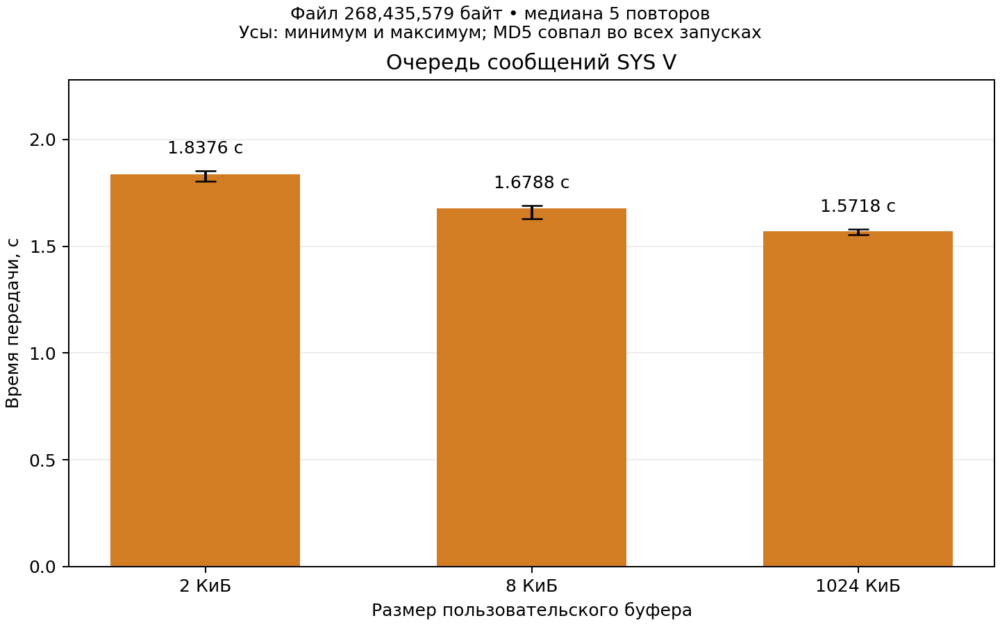
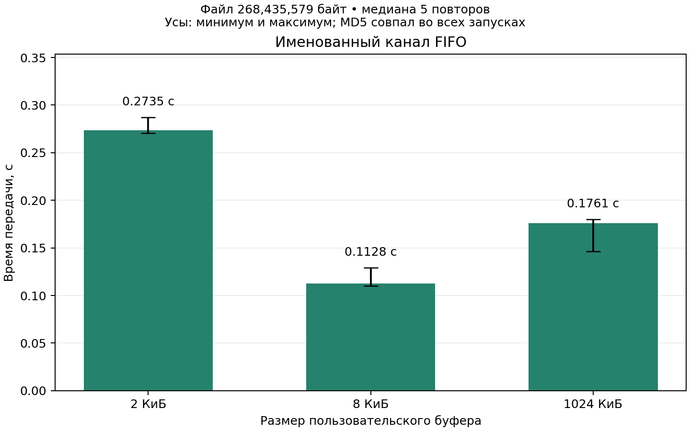
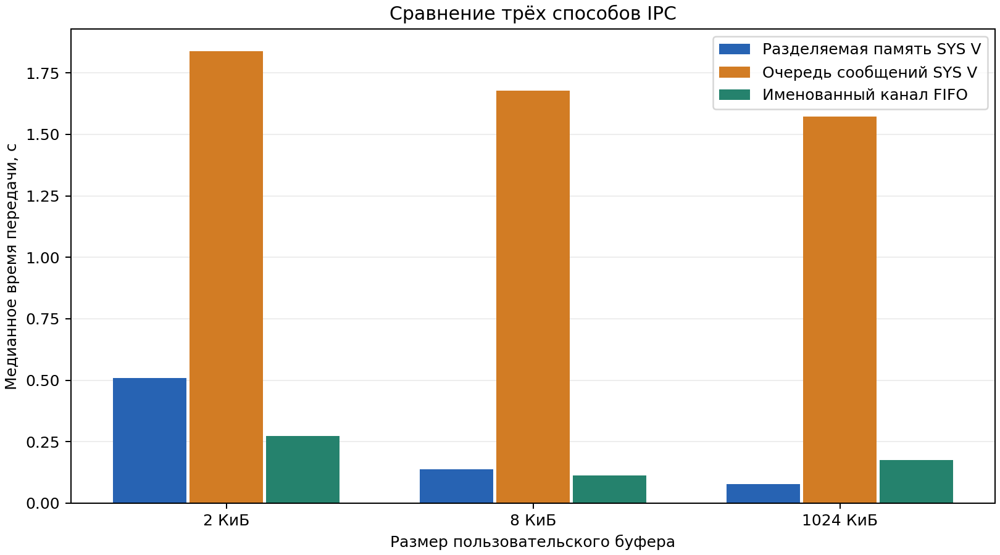

# Сравнение SYS V shared memory, SYS V message queue и FIFO

## Условия эксперимента

Измерения выполнены **21 октября 2026 года** на macOS 26.6.2
(Darwin 25.6.0), arm64, 10 логических процессоров. Компилятор —
Apple Clang 17.0.0, параметры сборки: `-O2 -std=c11 -Wall -Wextra -Wpedantic`.
Это результаты настоящего IPC между двумя процессами на macOS;
они не выдаются за измерения Linux.

Исходный файл — **268435579 байт (256 МиБ + 123 байта)**,
неразреженный, заполнен случайными данными `os.urandom`.
MD5 исходного файла:

```text
28d7fa8e9fb13ddec3caf9aa9f65bd99
```

Использована утилита `md5sum`. Во всех **54 передачах** (9 прогревочных
и 45 измеряемых) размер и MD5 полученного файла совпали с исходным.
Контрольные суммы каждого измеряемого запуска сохранены в
[measurements.csv](results/measurements.csv).

Лимиты определены программой `ipc_info`, настройки ОС не изменялись:

| Параметр | Измеренное значение |
| --- | ---: |
| Максимальный доступный размер данных одного сообщения SYS V | 2048 байт |
| Ёмкость очереди `msg_qbytes` | 2048 байт |
| Ёмкость FIFO при заполнении записями по 4096 байт до `EAGAIN` | 8192 байта |

Выбраны три размера пользовательского буфера:

| Размер | Байты | Обоснование |
| --- | ---: | --- |
| Малый | 2048 | Равен доступному размеру сообщения SYS V |
| Средний | 8192 | Равен измеренной ёмкости FIFO |
| Большой | 1048576 | В 128 раз больше измеренной ёмкости FIFO |

У очереди большой блок делится на сообщения не длиннее 2048 байт.
Сравнение не предполагает отправку сообщения длиной 1 МиБ, запрещённую
лимитами данной ОС. Для FIFO измерена ёмкость в условиях отдельной пробы;
она не считается неизменной при любых размерах записей.

## Методика

Каждая из трёх программ создаёт два процесса: отправитель читает исходный
файл, получатель записывает новый файл. Общий код работы с файлами и
измерения времени одинаков. Различается реализация IPC.

Измеряется `CLOCK_MONOTONIC` от момента перед `fork` до завершения
`waitpid`, когда получатель уже закрыл выходной файл. Включены создание
потомка, чтение файла, передача, запись результата и завершение потомка.
Создание ресурсов IPC, проба лимитов, генерация данных и MD5 находятся
вне измеряемого интервала. Таким образом, сравнивается полная передача
файла с файловым вводом-выводом, а не изолированная задержка IPC.

Для каждого из девяти сочетаний выполнен один прогрев и пять измеряемых
повторов. Порядок сочетаний перемешивается в каждом раунде
(`seed = 20261021`). Основная оценка — медиана пяти времён; дополнительно
показаны минимум и максимум. Это диапазон наблюдений, не доверительный
интервал. Исходный файл один и тот же во всей серии.

Работа выполняется с прогретым файловым кэшем: до замеров считается MD5
входа и проводится прогрев. `fsync` и сброс кэша не вызываются. Поэтому
результат включает принятие записей ОС, но не гарантирует их физическое
сохранение на накопителе. Фоновые процессы и выбор процессорных ядер
не контролировались.

## Численные результаты

Медианное время в секундах; меньше — быстрее:

| Способ IPC | 2 КиБ | 8 КиБ | 1 МиБ |
| --- | ---: | ---: | ---: |
| Разделяемая память SYS V | 0.508969 | 0.138027 | **0.076182** |
| Очередь сообщений SYS V | 1.837576 | 1.678811 | 1.571807 |
| FIFO | **0.273534** | **0.112755** | 0.176141 |

Диапазоны отдельных измерений:

| Способ IPC | Буфер | Минимум, с | Максимум, с |
| --- | ---: | ---: | ---: |
| Разделяемая память SYS V | 2 КиБ | 0.477417 | 0.519991 |
| Разделяемая память SYS V | 8 КиБ | 0.128047 | 0.179766 |
| Разделяемая память SYS V | 1 МиБ | 0.052719 | 0.082894 |
| Очередь сообщений SYS V | 2 КиБ | 1.806120 | 1.853942 |
| Очередь сообщений SYS V | 8 КиБ | 1.627383 | 1.689168 |
| Очередь сообщений SYS V | 1 МиБ | 1.555655 | 1.581193 |
| FIFO | 2 КиБ | 0.270741 | 0.287246 |
| FIFO | 8 КиБ | 0.110288 | 0.129002 |
| FIFO | 1 МиБ | 0.146456 | 0.180158 |

Полные параметры среды — [metadata.json](results/metadata.json),
машиночитаемая статистика — [summary.json](results/summary.json).

## Три гистограммы

На каждой гистограмме три столбца соответствуют малому, среднему и
большому буферу одного способа IPC. Высота — медиана времени, усы —
минимальное и максимальное время. Ось времени начинается с нуля.
Вертикальные масштабы индивидуальных графиков различаются; для
сравнения способов на одной шкале ниже дан общий график.

### Разделяемая память SYS V



[Версия PDF](results/shm.pdf).

### Очередь сообщений SYS V



[Версия PDF](results/mq.pdf).

### Именованный FIFO



[Версия PDF](results/fifo.pdf).

### Сравнение на общей шкале



## Объяснение и выводы

**Разделяемая память заметно выигрывает от увеличения блока.** Между 2 КиБ
и 1 МиБ медианное время сократилось примерно в **6.68 раза**. В этой
реализации один общий слот защищён двумя семафорами SYS V: на каждый блок
приходятся четыре `semop` и два копирования между локальными буферами и
сегментом. Укрупнение блока уменьшает число операций синхронизации и
файлового ввода-вывода. Это объяснение согласуется с измерениями; отдельная
стоимость `semop` в эксперименте не измерялась. Реализация не является
zero-copy. При 1 МиБ она быстрее двух остальных протестированных реализаций.

**У очереди выигрыш от большого буфера ограничен.** Между 2 КиБ и 1 МиБ
ускорение составляет около **1.17 раза**. Во всех трёх вариантах нужно
передать 131073 сообщения с данными и одно сообщение EOF: все выбранные
буферы кратны лимиту 2048 байта. Укрупнение пользовательского буфера
уменьшает число файловых `read`/`write`, но почти не меняет работу очереди.
На данной macOS очередь вмещает всего одно полное сообщение, что
ограничивает накопление данных между отправителем и получателем.
Это существенная особенность именно данного эксперимента.

**У FIFO лучший из трёх проверенных буферов — 8 КиБ.** Увеличение до 1 МиБ
ухудшило медианное время примерно в **1.56 раза**. Большой пользовательский
буфер не означает FIFO такой же ёмкости: чтение и запись могут дробиться
ядром, а получатель собирает блок перед записью в файл. Результат показывает,
что укрупнение буфера само по себе не гарантирует ускорения. Точную долю
затрат на копирование, пробуждения и поведение внутреннего буфера эта
серия не разделяет, поэтому конкретная причина замедления не объявляется
доказанной.

**Универсального победителя независимо от буфера нет.** На 2 и 8 КиБ
минимальное время получено у FIFO, на 1 МиБ — у разделяемой памяти.
SYS V очередь оказалась самой медленной для всех трёх размеров в этой
среде. Это вывод о данных программах и системных лимитах macOS, а не
доказательство, что любой FIFO или любая очередь всегда имеют такую
производительность. На Linux измерения нужно повторить: размеры
сообщений, ёмкости и реализация IPC могут отличаться.

**Корректность отделена от производительности.** Во всей измеряемой серии
содержимое подтверждено MD5. Дополнительные проверки пустых файлов,
неполных блоков, ошибок и передачи больше 4 ГиБ описаны в
[VALIDATION.md](VALIDATION.md). Времена разреженного файла из этих проверок
не смешиваются с результатами случайного файла выше.

## Воспроизведение

Из каталога `task_3_hw`, при установленном `matplotlib`:

```sh
make
python3 scripts/benchmark.py --size-mib 256 --repeats 5 --warmups 1 \
    --seed 20261021 --output-dir results_repeat
```

Новый случайный файл будет иметь другой MD5. Методика, выбор буферов по
лимитам машины, формат CSV и способ расчёта статистики останутся теми же.
